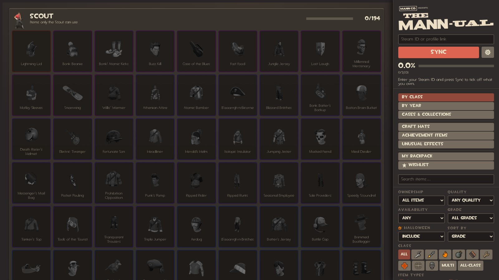

A Team Fortress 2 item checklist and collection tracker for traders, collectors, and archivists.

Enter a SteamID64, custom URL, or profile link to see which cosmetics, taunts, weapons, medals, tools, and other items you own or are missing.



## Features

- **Complete item catalog.** Builds its item list from TF2's game files, with automatic updates when item data changes.
- **Steam backpack sync.** View a public Steam backpack, including item descriptions, qualities, grades, paint, killstreaks, and unusual effects.
- **Collection tracking.** Track owned, missing, duplicate, and manually marked items. Create a wishlist for items you want to collect.
- **Quality tracking.** Browse items by Vintage, Genuine, Strange, Haunted, Collector's, and other qualities.
- **Class and item filters.** Filter by class, type, quality, grade, availability, Halloween restriction, and more. Sort by class, release date, collection, name, or other attributes.
- **Special item lists.** Browse craftable cosmetics, achievement rewards, and unusual effects.
- **Unusual effects.** Track cosmetic, taunt, and weapon effects, including special effects such as Community Sparkle and Map Stamps.
- **Stock weapons.** Track each class's default weapons and their collectible quality variants.
- **War paint preview.** Inspect war paints on 3D weapons, change wear and pattern seed, and browse available paints and weapons.
- **Mann Co. Store preview.** View items on 3D class models, with animations, team colors, paint, Halloween spells, styles, and unusual effects. Taunts play their own animation, voice lines, sound effects and music from your TF2 files, with play / pause and replay buttons under the merc.
- **TF2 interface.** Uses game fonts, icons, backpack borders, rarity colors, and interface sounds.
- **Item links.** Open the TF2 Wiki and Steam Community Market pages for supported items.
- **Customizable settings.** Adjust interface sounds, volume, scrolling behavior, and synchronization with your local TF2 installation.
- **Update check.** The app looks for a newer release on GitHub each time it starts and marks the Settings button when one is out. Settings > Updates shows your version and links to the download.

Items can be marked as unobtainable, limited, one-of-a-kind, unreleased, or code-exclusive. These classifications are curated and may not always be accurate.

## Run it

You need Python 3.8 or later, or the standalone Windows executable.

**Windows (no Python required)**

Download `The-Mann-ual-windows.zip` from the Releases page, extract it, and run the executable.

**Python (Windows, macOS, or Linux)**

```bash
git clone https://github.com/Chickenman456/TF2-Mannual.git
cd TF2-Mannual
python tf2_catalog.py
```

On Windows, you can also double-click `run.bat`.

The app opens in your browser at `http://127.0.0.1:8440`. It uses Python's standard library and requires no additional Python packages.

### Connecting TF2

TF2 does not need to be installed to use the checklist.

When TF2 is installed, the app can read item data, icons, war paints, patterns, and preview assets directly from your game files. Without a local installation, it downloads the public item data instead.

To specify your TF2 installation manually:

```bash
python tf2_catalog.py --tf "D:\SteamLibrary\steamapps\common\Team Fortress 2"
```

You can also change the installation path through **Settings → Sync with your game**.

## Data and maintenance

Most item information comes directly from TF2's files. Additional data is maintained in `data/` for information not reliably available in the game files.

| File | Purpose |
|---|---|
| `data/curation.json` | Hidden items, availability classifications, and corrections |
| `data/wiki_items.json` | Item qualities, tradeability, and Market availability |
| `data/crates.json` | Historical crate names, release dates, and contents |
| `data/achievements.json` | Achievement rewards and achievement metadata |
| `data/effects.json` | Unusual effect classifications and preview images |
| `data/release_dates.json` | Item release dates |

The app refreshes item data automatically and periodically updates its Wiki data. Maintainers can use the scripts in `tools/` to update release dates, crate information, and Wiki data.

**Contributions are welcome.** If an item is incorrectly classified, submit a pull request correcting the relevant entry in `data/curation.json`.

## Privacy

Everything runs locally on your computer. External requests are limited to:

- `steamcommunity.com` for public backpack data
- Steam image servers for item images
- `raw.githubusercontent.com` for item data when TF2 is not installed
- `wiki.teamfortress.com` for item icons and tradeability information

No Steam API key is required.

Your wishlist, synchronization results, backpack data, and settings are saved in the local `userdata/` directory and are not uploaded by the app.

## Project structure

```text
tf2_catalog.py       Application entry point
tf2c/                Catalog, Steam sync, VPK reader, and data sources
web/index.html       Main interface
web/preview.js       Mann Co. Store preview
web/store3d.js       3D character and weapon preview
web/pfx.js           Unusual particle effects
web/game.js          Local TF2 integration
web/models/          Character models and preview assets
web/vendor/          Three.js and related libraries
web/ui/              Interface artwork
web/fonts/           Fonts
web/sounds/          Interface sounds
data/                Item classifications and reference data
tools/               Data maintenance scripts
assets/              Application assets
```

## Legal

Team Fortress 2 artwork, fonts, sounds, character models, and related assets belong to Valve Corporation. Included game assets are subject to the applicable Source SDK 2013 license terms. The project is intended to remain free and non-commercial.

Three.js is MIT licensed. Certain portions of the code derived from or following `getgrenade/tf2-workbench` are subject to GPL-3.0 licensing requirements.

The project's original code is MIT licensed. Team Fortress, Steam, and their logos are trademarks of Valve Corporation. This project is not affiliated with or endorsed by Valve.

## Special Thanks

- [Team Fortress Wiki](https://wiki.teamfortress.com/) for item data and reference information.
- [GetGrenade's TF2 Workbench](https://github.com/getgrenade/tf2-workbench) for code and implementation references.
- [Itempedia.tf](https://itempedia.tf/) for unusual effect previews and item reference data.
