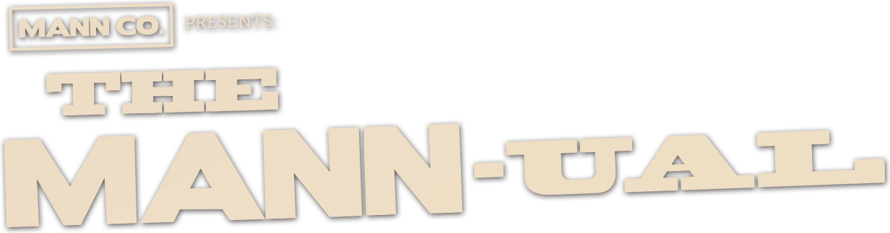

<p align="center"></p>

# The Mann-ual

> **AI Slop software "made" by Chickenman with Claude.** Uses Valve's Team Fortress 2 SDK. Special thanks to the TF2 Wiki and the TF2 Itempedia. Item data comes from TF2's own files, but the rules on top of it (release years, what counts as unobtainable, hidden items) can be wrong, so double-check before you trade, and send a pull request when you spot a mistake.

A checklist for Team Fortress 2 collectors (formerly TF2 Catalog). Type in any Steam ID and see every cosmetic, taunt, weapon, medal and tool you own and are missing, laid out like the in-game backpack.


- **Every item, always current.** The item list is built from TF2's own item files: your local install if you have one, otherwise the public SteamDatabase mirror, which updates within hours of every TF2 patch. New cases and cosmetics show up without waiting for this project to update.
- **Any account.** Sync with a SteamID64, a custom URL name, or a profile link. The backpack has to be public.
- **Single-quality items stand out.** Items that only exist in one quality, like the Genuine-only Boiling Point taunt, show their name in that quality's color. Community and tournament medals count as Genuine; list any exceptions under `not_genuine` in `curation.json`.
- **Unusual effects.** An Unusual Effects tab lists every cosmetic, taunt and weapon effect, plus special effects any item can carry (the Community Sparkle on Community and Self-Made items, Map Stamps). An effect counts as collected when an item you own carries it, and hovering it shows which of your items have it. Only items you can equip count for the normal effects, so a case that shows an effect in its description doesn't. Effect names come from the game files; preview images are from backpack.tf via [itempedia.tf](https://itempedia.tf/effects).
- **Craft Hats.** A tab with every cosmetic you can get by crafting, laid out by class.
- **Achievement Items.** A tab with every item unlocked by an achievement, grouped by game: TF2's class milestones, TF2's other achievements, then each other game (Alien Swarm, Poker Night, Spiral Knights, SpaceChem...). Rewards that aren't cosmetics or weapons (the SpaceChem crafting materials, Haunted Metal Scrap, spellbook pages) are listed too, as the Other item type, along with the Barely-Melted Capacitor and Glitched Circuit Board; the Power Up Canteen is an Action item. Achievement items wear a Steam-blue frame and the Steam icon of the achievement that unlocks them, in every tab; hovering one shows the achievement. Rewards that came out as a different item in earlier years count too: the Ghostly Gibus achievement used to give the Ghastly, Ghastlier or Ghastlierest Gibus (`achievement_variants` in `curation.json`). Which achievement gives which item comes from TF2's own item schema; `data/achievements.json` names the other games' achievements.
- **My Backpack.** Every item in your backpack from your last sync, 50 to a page like TF2's, with Steam's names, quality colors, grade borders and full descriptions (paint, killstreaks, effects, case contents...), and Wiki and Market links. Show it 50 to a page or as one continuous page, sort it by backpack order, newest, oldest, quality, type or name, and narrow it with the search box and the same filters as the checklist (type, class, quality, grade, availability, duplicates...).
- **Every quality.** Switch the checklist to Vintage, Genuine, Strange, Haunted or Collector's to see every item that exists in that quality and which ones you have. Strange Unusuals, Strange Genuines and so on count for both qualities.
- **Browse it your way.** By class, by release year, or by case and collection (a case and the collection it unlocks share one section, numbered by case). Sort by grade, class, equip region, name or most copies. Totals follow your filters as you change them, and switch to "left to collect" when you're showing Missing items. On wide screens, sync, views, search and filters sit in a column on the right and the items fill the rest; on narrower screens they're at the top, and the filters fold away behind one Filters button, with a one-line summary of what's active and a Reset. The top bar comes back when you scroll up; untick that in Settings if you'd rather it stayed at the top, and arrow buttons appear for jumping to the top or bottom of the page. The view tabs sit in three groups (the checklists, the special lists, and your backpack and wishlist). Filters work like TF2's backpack: dropdowns for Ownership, Quality, Availability, Grade, Halloween and Sort, the class icons, and checkboxes for item types and options. Filter by class, grade, owned, missing or duplicates, obtainable or unobtainable, Halloween-restricted, and multi-class items. War paints and decorated (war-painted) weapons are their own item types, and weapons can hide reskins, Botkillers and Festives. **Stock weapons** (each class's defaults) are an item type too: everyone has them, so they count as owned, and picking a quality (Strange, Unusual...) collects the real copies. **Action items** (the action slot: noise makers, canteens, spellbooks, gift piles, unlocked crates, the Duck Journal) are one, and **Tools** (keys, paints, name tags, Strange Parts and Filters, Killstreak Kits and the rest) another; paint cans and team paints show their own colour, drawn the way the game draws it (the can icon plus its paint overlay tinted with the paint's colour). Filters that can't change the list you're on fade out (Grade on Achievement Items, where nothing has a grade), and so do the choices that would match nothing there.
- **Unobtainable items flagged.** Items that can't be traded and aren't given out any more (Tux, old promo hats, community and tournament medals) are marked, and you can override any call.
- **Wishlist**, plus manual "I own this" marks for items held elsewhere.
- **Looks and sounds like TF2.** It uses TF2's real fonts, backpack borders, rarity colors, class art and item icons, plus the game's own UI sounds: button clicks, panel slides, and each item's own backpack pickup and drop sound when you tick it off. The megaphone button next to Sync mutes them.
- **Wiki and Market links** on every item (Market only when the item can be sold there).
- **Settings** (the gear next to Sync): interface sounds and their volume (the store preview's voice lines and taunt music follow it too), whether the top bar comes back when you scroll up, and **Sync with your game**.
- **The war paint window.** Click a war paint to open TF2's own war paint window (the inspection panel, from `inspectionpanel.res`), from Chickenman's TF2 UI redesign prototype: the painted weapon in 3D (drag to turn, wheel to zoom), the war paint and weapon lists, the wear slider, the seed and View on Market. Every war paint, its recipe and every pattern texture are read from your own TF2 files (`scripts/protodefs/proto_defs.vpd`, `resource/tf_proto_obj_defs_english.txt` and the texture VPKs), so nothing is bundled; it needs your TF2 folder linked.
- **The Mann Co. Store's preview window.** Click any item to open the store's item preview, rebuilt from the game's own `storepreviewitempanel.res` layout and art: the item's icon and details (level and type, who can use it, slot, whether you own it, its description, the Wiki page, the Steam Market), and a portrait for every class that can use it. Click a portrait to see the item on that merc in 3D: the class model plays its idle stance (or the taunt, for taunts) with face flexes and jiggle bones, bodygroups the item hides are hidden, and you can switch RED/BLU, apply any paint or a Halloween paint spell (Die Job, Chromatic Corruption, Putrescent Pigmentation, Spectral Spectrum, Sinister Staining, each animated through its colours and listed apart from the paints), pick a style from the Style dropdown under the merc (items that change in Pyroland, like the Jingle Belt, A Whiff of the Old Brimstone and the Captain's Cocktails, get a Pyroland style showing their baby bottles), zoom with the mouse wheel toward wherever the mouse is (from the full body in to a close-up of the head), drag the view around with the right or middle mouse button, turn it, or go full screen (the paint and style options and the Style and Unusual dropdowns come along). The first button under the viewport shows the item's backpack icon; the preview opens on the merc when the item has a model, and items with no model of their own (tools, paints, crafting items) show only their backpack icon, at full size from the game's `_large` texture when your TF2 files are linked. Shading is TF2's own (the skin shader's half-Lambert through `$lightwarptexture`, phong, rim light and the EyeRefract eyes, after the Source SDK 2013), ported from Chickenman's TF2 UI redesign prototype along with its merc engine. The class models ship with the app (`web/models/`); the items themselves are read from your own TF2 install, so link it in Settings > Sync with your game. Community and tournament medals show on the merc's chest, and weapons worn rather than held (the B.A.S.E. Jumper's pack, the Razorback, boots and shields) sit on the merc while he holds his next weapon. Bodygroups an item sets rather than hides come from the class model itself (the Purity Fist puts Heavy's hands bodygroup in its own state, the glove made for the augmented arm).
- **Every unusual effect, in the preview.** The Unusual dropdown under the merc lists every effect for the item's kind: cosmetic effects on hats, taunt effects on taunts, and Hot, Isotope, Cool and Energy Orb on weapons that can carry them. Pick one and it runs on the merc from TF2's own particle systems: `web/pfx.js` reads the `.pcf` files out of your install when you pick an effect (nothing is downloaded or bundled) and runs a port of the Source particle system (emitters, initializers, operators, forces and constraints, and the SpriteCard renderers: animated sprite sheets, sprite trails and ropes). Cosmetic effects sit on the item's `unusual` attachment or follow its root bone, as the game does; taunt effects at the merc's feet; weapon effects on the weapon's `unusual_0` attachment, in the version made for that weapon. Some effects use glow and smoke materials from the Half-Life 2 content TF2 also loads, so link the whole Team Fortress 2 folder (not just `tf`) to see those in full. A few taunt effects that need positions the game hands them during a taunt show only in part. In the Unusual Effects tab, clicking an effect opens it in the preview: cosmetic effects on the Unusual Cap, taunt effects on the Schadenfreude, weapon effects on the stock Rocket Launcher.
- **Without a link to your TF2 files**, the preview window still opens, with the merc, the store's taunts and the stock weapons.

## Run it

You need either **Python 3.8+** or the Windows .exe from the Releases page. TF2 doesn't have to be installed.

**Windows, no Python:** download `The-Mann-ual-windows.zip` from Releases, unzip, and run the .exe.

**With Python (any OS):**

```
git clone https://github.com/Chickenman456/TF2-Mannual.git
cd TF2-Mannual
python tf2_catalog.py          # Windows: double-click run.bat
```

Your browser opens at `http://127.0.0.1:8440`. There's nothing to install: the app uses only Python's standard library.

If TF2 is installed, the app finds it through Steam and reads the item list, icons and the store preview's items straight from your game files. Without it, the app downloads TF2's item files instead (and the store preview can't put items on the merc). Use Settings > Sync with your game to switch, or pass the folder directly:

```
python tf2_catalog.py --tf "D:\SteamLibrary\steamapps\common\Team Fortress 2"
```

## Privacy

- Everything runs on your computer. Outside requests go only to `steamcommunity.com` (the public backpack of the ID you enter), Steam's image servers, `raw.githubusercontent.com` (TF2 item files, when TF2 isn't installed) and `wiki.teamfortress.com` (icons, quality lists, and which items can be sold on the Market). No Steam API key is needed.
- Your wishlist, sync results, backpack and settings are saved in `userdata/` next to the app. That folder is git-ignored and never leaves your machine.

## Keeping it up to date

There's nothing to do. The app checks for changed TF2 item files when it starts (and every few hours) and rebuilds the list if they changed. That takes about a second.

### Icons

Each item's icon comes from the first of these that has it. No Steam API key is needed for any of them:

1. Your local TF2 install, decoded in the browser.
2. The TF2 Wiki's "Item icon" images (about 99% of cosmetics and taunts).
3. Steam's images of items in your backpack, picked up when you sync. These fill gaps like medals.

War paints and decorated weapons use the TF2 Wiki's painted backpack images (the same pictures the Steam Community Market shows), so you see the actual paint instead of the plain weapon.

Some facts aren't in the game files, so they live in `data/`:

| File | What it holds |
|---|---|
| `data/curation.json` | Items to hide (unreleased, robot-only, placeholders), untradable items that are still earnable, and fixed release dates. Edit by defindex, ranges allowed (`"100-120"`). |
| `data/wiki_items.json` | Which items exist in each quality, and which can be traded or sold on the Market, from the TF2 Wiki. The app refreshes this by itself about once a week; `tools/update_wiki_data.py` refreshes the bundled copy. |
| `data/crates.json` | Names, dates and contents of old crates whose series number or contents are missing from the game files (the Robo Community Crate, for example), from the TF2 Wiki. `tools/update_crates.py` refreshes it. New crates and cases don't need it. |
| `data/achievements.json` | The names of other games' achievements that unlock TF2 items (from each game's Steam achievement page), items crafted from achievement rewards, and where each achievement's Steam icon sits in `web/ui/achievements.webp`. |
| `data/effects.json` | Which unusual effects are released, and where each one's preview sits in `web/ui/effects.webp`. Effects newer than this list still show up, just without a preview. |
| `data/release_dates.json` | Release dates for existing items. Items newer than this list are dated by their case, store date, or the day the app first saw them. Maintainers can run `tools/update_release_dates.py` to add exact dates. |

Pull requests to `curation.json` are the easiest way to help, for example when an item is wrongly marked obtainable.

## Reskins, Botkillers and Festives

A weapon counts as a reskin when its stats are identical to an earlier weapon or the stock one (the Frying Pan, Saxxy, Nessie's Nine Iron, the Big Kill...). That's checked automatically from the game files; `reskins` and `not_reskins` in `curation.json` fix the cases it gets wrong. "Hide Festives" hides every Festive weapon.

## How "unobtainable" is decided

An item counts as unobtainable when it **can't be traded** and **isn't given out any more**:

- Every community and tournament medal is unobtainable.
- An untradable cosmetic or taunt released more than a year ago is unobtainable, unless it's an achievement item (those are earned again by anyone who gets the achievement) or `curation.json` lists it as still earnable: Gibuses, dueling badges, MvM badges and the Birthday Hat are on that list. Achievement items from promotions that have ended (the Triclops, Flamingo Kid, Bolt Action Blitzer, Black Rose and Frontline Field Recorder) are listed under `unobtainable`.
- Tradable items count as obtainable, because you can trade for them, even from retired cases. Two finer labels sit on top:
  - **Limited**: tradable, but it only came from a promotion that has ended, so no new copies are made (Bill's Hat, Earbuds, Max's Severed Head). Items listed under `limited` in `curation.json` are Limited whatever the wiki says, with the note shown: the original Poker Night at the Inventory items, now that the 2026 remaster unlocks the Reissued versions instead.
  - **1 of 1**: only a single copy exists (Uncle Sam, the Top Notch, the workshop award items). Hand-picked under `one_of_one` in `curation.json`. Items that only stay in a backpack for a day (the Dueler, Philateler and Gifting Man from Gifting Land) also get the game's stopwatch icon, from `one_day`.
- **Unreleased**: items in the game files that were never given out (the Jungle Inferno park hats, and the Genuine Ye Olde Baker Boy and Vintage Tyrolean, whose NECA figures never came out).
- **Code**: items whose copies came from redeeming promo codes (the Genuine Tough Guy's Toque, the Yogscast charity medals from Heart of Gold and Thought that Counts to the Jingle Jam ones, Proof of Purchase). Unused codes may still redeem, so they're technically obtainable. The Code filter shows each one in the quality its codes gave out, and only a copy in that quality ticks it off (a Genuine Balloonicorn, not a Unique one). They're listed with their quality under `code_items` in `curation.json`. Each one's notes say which product its code came with (the NECA action figures, Sam & Max: The Devil's Playhouse from the Telltale Games store, the Yogscast Jingle Jam). Codes that were never given out because their product was never released (the BLU Scout and BLU Medic NECA figures' Genuine Ye Olde Baker Boy and Vintage Tyrolean) count as Unobtainable.
- **Expired**: items that deleted themselves from every backpack on a set date (the 2013 Halloween spells, Costume Transmogrifiers, Voodoo-Cursed items). They're their own item type, read from the expiration dates in the game files.

## Project layout

```
tf2_catalog.py      entry point
tf2c/catalog.py       builds the item list from items_game.txt + localization
tf2c/vpk.py           reads textures out of TF2's VPK archives
tf2c/locate.py        finds the TF2 install on Windows/macOS/Linux
tf2c/steam.py         reads a public backpack from Steam
tf2c/server.py        local web server
tf2c/sources.py       downloads TF2 item files when TF2 isn't installed
tf2c/icons.py         picks an icon source per item
tf2c/wikidata.py      quality lists and Market flags from the TF2 Wiki
web/index.html        the interface
web/preview.js        the Mann Co. Store preview window
web/store3d.js        its 3D merc: class models, animation, faces, TF2 shaders, and the reader for your TF2 files
web/pfx.js            unusual effects: TF2's particle systems (.pcf) run on the merc
web/game.js           links your TF2 folder (web page) or install (app) for the store preview
web/models/           class models, skins, face data and stock weapons, packed (tools/pack_models.py)
web/vendor/           three.js 0.147 with its GLTFLoader and OrbitControls
web/ui, web/fonts     TF2 interface art and fonts
web/sounds            TF2 UI and backpack sounds
data/                 curation lists and release dates
assets/tf2catalog.ico the app / .exe icon
tools/                maintainer scripts for release dates, wiki data and old crates
```

## Legal

The interface art in `web/ui/`, the fonts in `web/fonts/` and the sounds in `web/sounds/` come from Team Fortress 2 and belong to Valve. They're included under the Source SDK 2013 license terms, which only cover free, non-commercial projects, so keep it free. So do the class models, skins, face data and stock weapons packed in `web/models/` (converted from the game's files for the store preview), under the same terms. Item icons and item models aren't bundled: they load from Steam, the TF2 Wiki or your own install. `web/vendor/` is three.js 0.147 with its GLTFLoader and OrbitControls (MIT licensed, license alongside it). The TF2 file reader in `web/store3d.js` notes that parts of it (item classification, duplicate-weapon filtering, extra and attached models, icon decoding) follow getgrenade/tf2-workbench, which is GPL-3.0; those portions carry that license. Team Fortress, Steam and their logos are trademarks of Valve Corporation. This project isn't affiliated with or endorsed by Valve. The code is MIT licensed.
